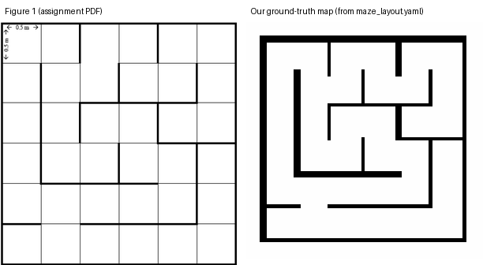
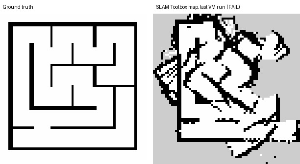

# Autonomous Navigation of TurtleBot3 Burger in Gazebo (ROS 2 Jazzy)

**IE4060 Robotics and Intelligent Systems - Assignment 02**

| | |
|---|---|
| GitHub repository | https://github.com/AseshNemal/ros2-autonomous-maze-navigation (branch `dev-integration`) |
| Group members / contributions | see the table below and `docs/OWNERSHIP.md` |
| Environment | Ubuntu 24.04 (ARM64 VM, 4 CPUs, 3 GB RAM), ROS 2 Jazzy, Gazebo Harmonic, Nav2, SLAM Toolbox |

| Member (GitHub user) | Package | Contribution |
|---|---|---|
| Member 1 - JayangaWeerasinghe | `maze_simulation` | environment-versions document, test-map assets, optional prototype world `custom_maze` (3 commits on `main`) |
| Member 2 - dhanushka403 | `slam_mapping` | partial prototype map `test_map` (1 commit, PR #1) |
| Member 3 - RavinduYashas | `maze_navigation` | Nav2 parameters, launch file, RViz layout, goal evaluator (7 commits, PR #2) |
| Member 4 - AseshNemal | `dqn_agent` | NumPy Double DQN, environment, training/evaluation/comparison, Stage-1 trial (2 commits, PR #3) |
| Integration - AseshNemal (AI-assisted, labelled as such) | all four | Figure-1 maze generator and world, bridge/spawn, watchdog, SLAM tour and validation, Nav2 fixes, three-goal script, VM verification scripts, DQN maze adaptation |

Student names and IDs are to be added on the submitted cover page. Original teammate commits are preserved unmodified in the Git history; `docs/OWNERSHIP.md` separates them from the integration work.

> **Honesty note.** Every number in this report comes from a recorded run in `docs/results/vm/` (command, date and log are in that folder). Where a requirement was not met, the report says so. Items marked **NOT MEASURED** have no data yet.

## 1. Introduction and system overview

The robot is a TurtleBot3 Burger with a 360-beam LiDAR (3.5 m range, about 5 Hz in our VM). It must reach goals clicked in RViz inside the maze of Figure 1 of the brief, with minimal travel time and without collisions. The project has four ROS 2 packages, one per team member:

| Package | Role |
|---|---|
| `maze_simulation` | Gazebo world generated from the maze layout, TurtleBot3 spawn, `ros_gz_bridge`, dead-man command watchdog, verification scripts |
| `slam_mapping` | SLAM Toolbox mapping, map saving, map validation against the layout, AMCL localisation, mapping driver |
| `maze_navigation` | Nav2 (NavFn A\* planner + Regulated Pure Pursuit controller), RViz configuration, three-goal metric script |
| `dqn_agent` | Double DQN (NumPy), training, evaluation and comparison with Nav2 |

Nav2 and DQN are alternative controllers of the same robot; they are never run together.

## 2. Maze design

Figure 1 is a 6 x 6 grid of 0.5 m cells (3 m x 3 m). Thick lines are walls, thin lines are open cell boundaries; wall positions were taken from the figure's line thickness and stored in `maze_layout.yaml`. A generator (`maze_tools.py`) produces the Gazebo SDF world (walls 0.05 m thick, 0.5 m high) and a ground-truth occupancy map from the same file, so the simulated maze, the validation map and the path-planning graph cannot disagree. The free corridor is 0.45 m, only about 2.5 times the Burger's diameter, which makes the maze hard for the costmaps and controller (Section 7). The robot starts in the bottom-left cell; the three evaluation goals are cells (0,5), (2,0) and (3,3).

Verification: the committed `maze.world` equals its regeneration from the layout (`tools/verify_static.py`), the headless simulation loads it, and a raycast of the ground-truth map from the robot's true pose reproduces the real LiDAR scan with a mean range error of 0.05 m. The layout was also compared with Figure 1 automatically (Section 2.1).

### 2.1 Figure-1 check and the additional prototype world

`tools/check_figure1.py` re-measures Figure 1 from the assignment PDF (the 480 x 493 image, line widths sampled at three points on each of the 60 interior cell boundaries) and compares the wall set with `maze_layout.yaml`: **12 vertical + 12 horizontal interior walls, 0 differences** (static check, not a Gazebo run). The figure is a 6 x 6 grid.

The repository also contains `worlds/custom_maze.sdf`, a separate prototype by a team member (JayangaWeerasinghe, `generate_maze.py`): a 7 x 6 grid with 0.2 m high, 0.01 m thick walls. It is **not** Figure 1 (7 columns instead of 6, different wall set and size), so it is not the required environment and **no reported result was obtained in it**. It is kept as an optional world (`world:=custom_maze`, README); that it loads and spawns the robot has not been tested yet.

## 3. Navigation method

**Mapping and localisation.** SLAM Toolbox (asynchronous, loop closing disabled because the simulated odometry is clean and the self-similar 0.5 m corridors produced false loop closures) builds an occupancy grid. The mapping driver `tour_map_drive.py` drives through every cell along open corridors (a greedy nearest-unvisited tour over the cell graph, 48 waypoints, about 23.5 m, 0.12 m/s, slow in-place turns so consecutive 5 Hz scans overlap). The layout is used only to choose where to drive; the map itself comes from the LiDAR. AMCL localises on the saved map.

**Planning and control.** Nav2 plans with the NavFn planner in A\* mode on the global costmap (resolution 0.05 m, planning radius 0.08 m, inflation 0.25 m) and follows the path with the Regulated Pure Pursuit controller (0.15 m/s). Nav2 output passes through the velocity smoother and the collision monitor to a small node that converts `Twist` to the `TwistStamped` the Gazebo bridge expects. Goals are chosen with RViz's standard *Nav2 Goal* tool (`/goal_pose`).

**Machine learning.** A Double DQN (NumPy, 15-dimensional state: 12 LiDAR sectors plus goal distance and bearing, five discrete actions, dense progress reward, collision penalty) is trained in the same Gazebo world and evaluated greedily on the same three start-goal pairs as Nav2.

## 4. Results

### 4.1 Simulation interface (headless, `verify_on_vm.sh sim`)
7 of 7 checks passed: `/scan`, `/odom`, `/clock`, frames, `odom -> base_footprint` TF, `/cmd_vel` is `TwistStamped`. LiDAR about 4.4 Hz, odometry about 43 Hz.

### 4.2 Nav2 three-goal test (`nav2_results_20261016-214253.csv`, ground-truth map, robot reset to the start before each goal)

| Goal (world x, y) | Outcome | Time (sim s) | Travelled (m) | Recoveries | Reference (m) | Reference / travelled |
|---|---|---|---|---|---|---|
| 1 (1.25, 1.25) | SUCCEEDED | 44.52 | 5.97 | 0 | 8.0 | 1.34 |
| 2 (-1.25, 0.25) | SUCCEEDED | 14.63 | 1.93 | 0 | 2.5 | 1.30 |
| 3 (0.25, -0.25) | SUCCEEDED | 20.34 | 2.78 | 0 | 3.5 | 1.26 |

3 of 3 goals reached, no recoveries. The "reference" is a cell-count estimate (0.5 m per cell), not a true lower bound, so the ratio exceeds 1; the planner's own path for goal 1 was 6.9 m. (This CSV's method label still reads `nav2_navfn_astar_mppi` because it was recorded before the controller was relabelled; the controller was Regulated Pure Pursuit.)

Earlier runs, kept in `docs/results/vm/`, document the path to this result: 0 of 3 (Nav2 never started: lowercase `"false"` passed to Nav2's launch file), then 0 of 3 and 2 of 3 with the MPPI controller (zero velocity output in 0.45 m corridors; start pose inside inflated cells).

### 4.3 SLAM map (`validate_map.py`, thresholds: coverage >= 0.85, precision >= 0.85, free cells correct >= 0.95)

| Run | Coverage | Precision | Free OK | Result |
|---|---|---|---|---|
| Wall follower, loop closing on (stale processes interfering) | 0.586 | 0.356 | 1.0 | FAIL |
| Wall follower, loop closing off | 0.760 | 0.647 | 0.889 | FAIL |
| Wall follower, slower, side-by-side phases | 0.518 | 0.821 | 1.0 | FAIL |
| Coverage tour, creeping bug (hit the 15 min limit, tour incomplete) | 0.669 | 0.708 | 0.944 | FAIL |
| Coverage tour, creeping bug fixed (tour completes, 47/47 waypoints, about 5 min) | 0.759 | 0.577 | 0.944 | **FAIL** |

One further run was discarded: its saved map came from a stray Nav2 map server, not SLAM (identical to the ground-truth map); the script now refuses to save unless `slam_toolbox` is the only `/map` publisher.

**The SLAM map does not meet our own validation thresholds.** The map has the right size and recognisable structure, but walls are smeared (precision) and about a quarter of the wall length is not scanned. Navigation therefore uses the ground-truth map in the test above; navigation on the SLAM map was not demonstrated.

*Diagnosis from the saved map (offline, `docs/cloud_analysis.md`).* Re-validating the committed map reproduces the 0.759 / 0.577 above. It is distorted, not merely offset: the best rigid re-alignment only reaches precision 0.598, and only 20 % of line-like wall pixels are within 5 degrees of a maze axis (77 % for the ground-truth map): the heading was lost part-way through the tour. A simulated perfect-pose LiDAR map of the same tour passes (1.0 / 1.0), so the tour and the validator are not the limit; the validator tolerates only about 0.2 degrees of uncorrected heading drift per metre. Odometry was accurate in the control test (yaw within 0.04 rad per turn). The most likely cause is the scan-matcher search window (+-0.5 m, +-20 degrees), far larger than the odometry error in 0.45 m self-similar corridors. We narrowed it to 0.2 m and 10 degrees; **this change has not been run in Gazebo yet**, so the table above is unchanged and the SLAM requirement is still unmet.

### 4.4 Remote / manual control (`verify_on_vm.sh control`, `check_control.py`)
Real `teleop_twist_keyboard` driven through a pseudo-terminal; robot motion compared between `/odom` and Gazebo's ground truth. First run: 21 of 22 checks passed (spawn, `/odom`, `/scan`, TF, message type, bridge, forward +0.46 m, backward -0.32 m, left +1.01 rad, right -1.03 rad, stop, Nav2 goal reached in 21 s, only the Nav2 chain publishing during Nav2, real-time factor 1.00). The one failure was a genuine safety defect: after teleop was killed mid-motion, Gazebo kept executing the last command (0.15 m/s, 0.39 m in 2.5 s). A command watchdog (`cmd_vel_watchdog.py`) was added; see Section 4.6 for its re-test.

### 4.5 DQN (`dqn_train_20261017-000035.csv`, `dqn_eval_20261017-000035.csv`; 5-episode timing run `dqn_train_20261016-235928.csv`)
Unit tests pass (11 of 11). Timing test: 5 episodes lasted about 5 s of simulated time each (collision after 6 to 16 steps), roughly 4 to 6 s of wall time per episode, so training cost was measured rather than assumed. Real training: **50 episodes, 595 optimizer updates, pure DQN (no guidance)**: 0 successes, 50 collisions, mean 13.9 steps and 5.5 simulated seconds per episode, mean reward -45.9, epsilon still 0.967 at the end (exploration had barely started to decay). Greedy evaluation on the three Nav2 goals, 3 trials each: **0 of 9 reached the goal**; every trial ended in a collision after 6 to 8 steps. **The DQN did not learn to navigate the maze in 50 episodes.** This is expected for so little training (an earlier trial also reached 0 of 3), and longer training was not attempted: it is not evidence either way about the method with more training. The comparison with Nav2 is therefore Nav2 3/3 against DQN 0/9.

*Diagnosis without Gazebo (offline, `docs/cloud_analysis.md`).* The 50 episodes made only about 700 environment steps because each ended in a collision, so epsilon (decayed over 20 000 steps) never left random exploration. A kinematic surrogate of the environment (real agent and reward, ray-cast LiDAR on the real maze, no Gazebo) reproduces this run (0 successes). The surrogate also exposed a defect in the hybrid (waypoint) mode: the waypoint switched 0.25 m from a cell centre, i.e. on entering the 0.5 m cell, so each turn cut into the corner (success 92 % for one-cell paths, 29 % for two, 14 % for three). We changed the tolerance to 0.15 m and the epsilon decay to 3000 steps. On the surrogate this gives 20 of 30 greedy trials on the three assignment goals for the hybrid agent, while a pure DQN, which sees only local LiDAR and a straight-line bearing, stays at 0 of 30. **These are surrogate numbers, not Gazebo results**; the new settings have not been run in Gazebo and the table above is unchanged. A DQN that reaches goals only with A\* waypoints is a hybrid and will be reported as one.

### 4.6 Watchdog re-test (`control_teleop_20261016-235730.json`, `control_nav_20261016-235730.json`)
After adding the watchdog: **22 of 22 checks passed** (teleop 16/16, Nav2 6/6). Killing teleop mid-motion now leaves the robot at 0.000 m/s with 0.00 m moved in the following 2.5 s (before: 0.15 m/s, 0.39 m). The Nav2 goal was reached in 13 s. Not verifiable by script: remote-desktop input delay and disconnections; the simulation itself ran at a real-time factor of 1.00 (headless).

## 5. Challenges faced (all from real runs)
1. **Nav2 would not start.** Nav2's launch file evaluates arguments as Python; the lowercase `"false"` raised a NameError.
2. **Leaked processes.** A previous stage's `ros_gz_bridge` kept republishing `/clock`, `/tf` and `/scan` into the next simulation: 58 clock-jump warnings, TF extrapolation errors and dropped scans. After fixing the cleanup: 0, 0 and 0.
3. **Controller stalls.** MPPI produced zero velocity in 0.45 m corridors; Regulated Pure Pursuit and a smaller planning footprint fixed it.
4. **Verification scripts hid failures.** Stages printed "finished" after failed validation; they now report `STAGE RESULT: PASS|FAIL` and exit non-zero.
5. **Wall following cannot map interior wall islands**, and a safety rule tripped on minimum-range LiDAR returns, making the robot creep; replaced by the coverage tour with that fix.
6. **GUI configuration.** RViz used an unmodified generic Nav2 layout centred 5 m away from the maze and a custom Gazebo GUI block; both replaced by standard configurations (`docs/gui_review.md`).
7. **Small VM.** Concurrent Gazebo, Nav2 and RViz on 3 GB RAM; Nav2's 4 s lifecycle heartbeat shut navigation down, so it was raised to 30 s.

## 6. Limitations
SLAM map fails our validation thresholds; Nav2 was tested only on the ground-truth map, from reset start poses, in three runs; DQN has no Gazebo goal-reaching result; the fixes in Sections 4.3 and 4.5 are untested in Gazebo; travel-efficiency uses a cell-count reference rather than the planner path; the LiDAR rate was about 4.4 Hz on a 3 GB VM; collisions are detected from LiDAR range, not a contact sensor.

## 7. Possible improvements
SLAM accuracy (tune scan-matching parameters, slower motion, re-enable loop closure with stricter thresholds, evaluate with a real exploration algorithm such as frontier exploration); navigate on the SLAM map instead of the ground-truth map; measure path efficiency against the planner's path rather than a cell-count estimate; longer and randomised DQN training, LiDAR history in the state, PyTorch with prioritised replay; a contact sensor for collision counting; automated cross-checking of the maze against Figure 1.

## 8. How to reproduce
`bash tools/run_all.sh` (all stages, headless) or `bash tools/verify_on_vm.sh <build|sim|slam|nav|control|dqn>`; live demo `bash tools/demo.sh`. Details in `README.md`; the Ubuntu test order is `docs/ubuntu_test_checklist.md`.
