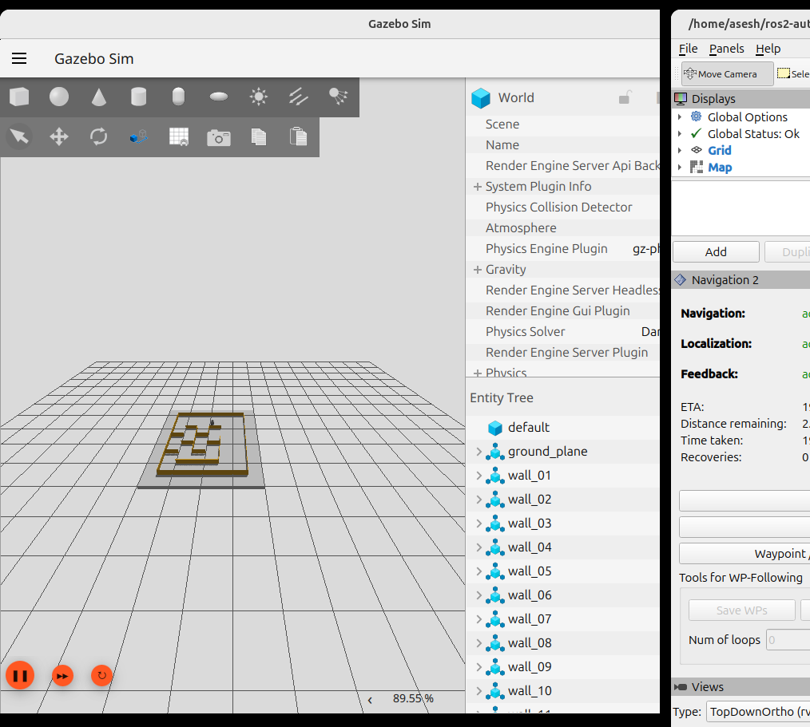
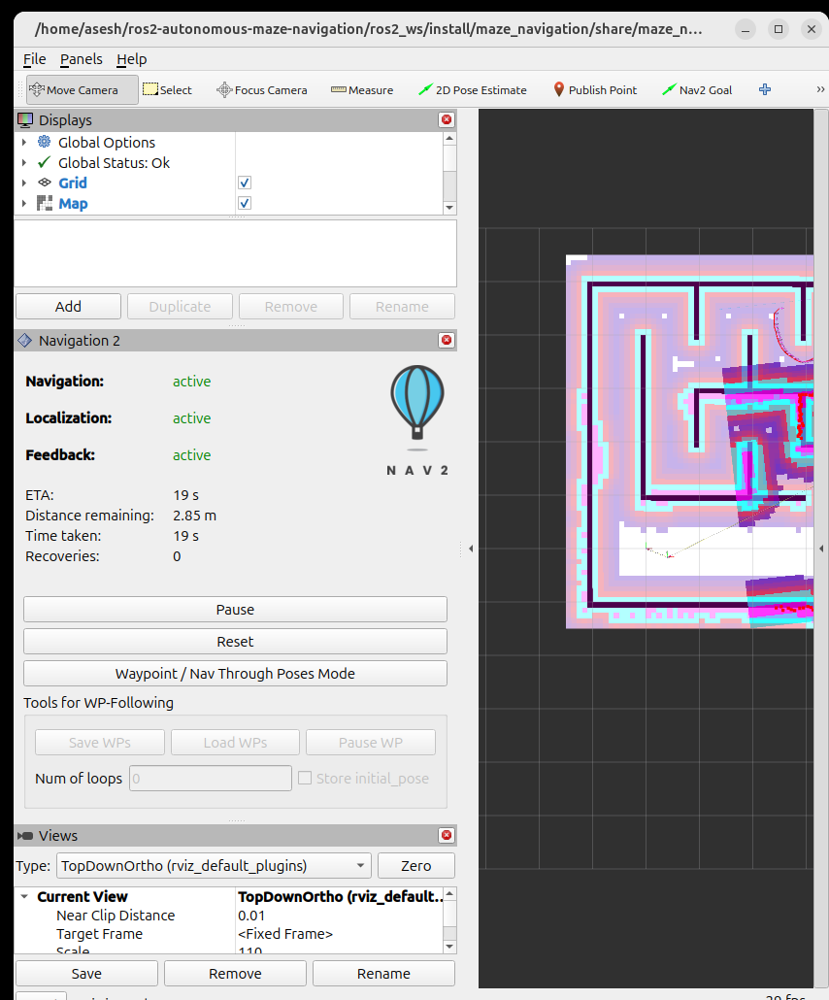

# Autonomous Navigation of TurtleBot3 Burger in Gazebo (ROS 2 Jazzy)

**IE4060 Robotics and Intelligent Systems - Assignment 02**

| | |
|---|---|
| GitHub repository | https://github.com/AseshNemal/ros2-autonomous-maze-navigation (branch `dev-integration`) |
| Environment | Ubuntu 24.04 (ARM64 VM), ROS 2 Jazzy, Gazebo Harmonic, Nav2, SLAM Toolbox |

| Member (GitHub user) | Student ID | Name | Package and assigned responsibility | Contribution (GitHub record, unchanged) |
|---|---|---|---|---|
| Member 1 - JayangaWeerasinghe | IT22273680 | Weerasinghe KGJP | `maze_simulation` - Maze Environment and Simulation | environment-versions document, test-map assets, optional prototype world `custom_maze` (3 commits on `main`) |
| Member 2 - dhanushka403 | IT23367562 | Lakshitha W G D | `slam_mapping` - Mapping and Localization | partial prototype map `test_map` (1 commit, PR #1) |
| Member 3 - RavinduYashas | IT23185470 | Yashas S.P.R | `maze_navigation` - Nav2 Navigation and Evaluation | Nav2 parameters, launch file, RViz layout, goal evaluator (7 commits, PR #2) |
| Member 4 - AseshNemal | IT23236264 | Nemal L A | `dqn_agent` - Deep Q-Learning | NumPy Double DQN, environment, training/evaluation/comparison, Stage-1 trial (2 commits, PR #3) |
| Integration - AseshNemal (AI-assisted, labelled as such) | - | - | all four packages | Figure-1 maze generator and world, bridge/spawn, watchdog, SLAM tour and validation, Nav2 fixes, three-goal script, VM verification scripts, DQN maze adaptation |

The contribution column is the original GitHub record and has not been edited; the name, ID and responsibility columns are the team's assignment. For the current state: the world used for every result in this report is `custom_maze.sdf` with its generator `generate_maze.py`, both committed on `main` through Member 1's GitHub account (Section 2). Original teammate commits are preserved unmodified in the Git history; `docs/OWNERSHIP.md` separates them from the integration work.

> **Honesty note.** Numbers marked as measured come from recorded runs on the Ubuntu VM, stored in `docs/results/vm/` (current maze), `docs/results/old_6x6_maze/` (previous maze, labelled) or, for the offline analyses, `docs/cloud_checks/` (labelled as not Gazebo). All measurements were taken on the Ubuntu VM on 2026-10-17; each result names its evidence file. Where a requirement is not met, the report says so.

## 1. Introduction and system overview

The robot is a TurtleBot3 Burger with a 360-beam LiDAR (3.5 m range, about 5 Hz in our VM). It must reach goals clicked in RViz inside the maze, with minimal travel time and without collisions. Four ROS 2 packages, one per member:

| Package | Role |
|---|---|
| `maze_simulation` | Gazebo world (`worlds/custom_maze.sdf`), TurtleBot3 spawn, `ros_gz_bridge`, dead-man `/cmd_vel` watchdog, layout reader `maze_tools.py`, verification scripts |
| `slam_mapping` | SLAM Toolbox mapping, map saving, map validation against the world, AMCL localisation, coverage-tour mapping driver |
| `maze_navigation` | Nav2 (NavFn A\* planner + Regulated Pure Pursuit controller), RViz configuration, three-goal metric script |
| `dqn_agent` | Double DQN (NumPy), training, evaluation and comparison with Nav2 |

Nav2 and DQN are alternative controllers of the same robot; they are never run together.

## 2. Maze design

The maze is the simulation member's Gazebo world `ros2_ws/src/maze_simulation/worlds/custom_maze.sdf` (generated by `generate_maze.py`; the SDF is the Gazebo world file for this submission, used unmodified, world name `custom_maze`): a 7 x 6 grid of 0.5 m cells (3.5 m x 3.0 m; outer walls x -0.5..3.0, y -0.5..2.5) with thin 0.01 m, 0.2 m high walls. The bottom corridor is 1 m wide and the narrowest corridors are one cell (0.5 m) wide. The robot spawns in the bottom corridor at (0.25, 0.0). The three evaluation goals are cells (0,3), (3,3) and (3,0), with grid routes of about 5.5 m, 3.0 m and 1.5 m (`config/mission.yaml`). `maze_tools.py` reads the walls from the SDF and rasterises them into the ground-truth occupancy map and the cell graph used for path references.

**Figure 1 mismatch.** The assignment's Figure 1 is a 6 x 6 grid (3 m x 3 m). Our world is 7 columns x 6 rows with a different wall set (visible above), so it is an approximation of the figure and **not an exact match** (`tools/check_figure1.py` reports FIGURE1 MISMATCH). A 6 x 6 layout verified against the figure existed earlier in the Git history but was replaced by the team's agreed world.

**Map defect found and fixed during final checking.** The generated ground-truth map was missing the whole east outer wall (wall edges lie exactly on pixel edges, so float noise dropped it). It is fixed (deterministic tie-break in `maze_tools.write_map`), the map is regenerated, and a test (`slam_mapping/test/test_groundtruth_vs_sdf.py`) now compares the map with every wall of the SDF. An earlier Nav2 run used the old map; the scripted run on the corrected map is reported in C2.

## 3. Navigation method

**Mapping and localisation.** SLAM Toolbox (asynchronous, loop closing disabled because the self-similar 0.5 m corridors produced false loop closures; scan-matcher search window narrowed to 0.2 m) builds an occupancy grid. The mapping driver `tour_map_drive.py` drives through every cell along open corridors (a greedy nearest-unvisited tour over the cell graph, 56 waypoints in the current maze, 0.12 m/s, slow in-place turns so consecutive 5 Hz scans overlap). The layout is used only to choose where to drive; the map itself comes from the LiDAR. AMCL localises on the saved map.

**Planning and control.** Nav2 plans with the NavFn planner in A\* mode on the global costmap (0.05 m resolution, inflation 0.25 m) and follows the path with the Regulated Pure Pursuit controller (0.15 m/s). Output passes through the velocity smoother and the collision monitor to a small node that converts `Twist` to the `TwistStamped` the Gazebo bridge expects. Goals are chosen with RViz's *Nav2 Goal* tool (`/goal_pose`). The global costmap uses a planning radius of 0.08 m, slightly below the Burger's 0.105 m, as a deliberate trade-off for the 0.5 m corridors; the local costmap (0.11 m) and the collision monitor cover the real footprint.

**Machine learning.** A Double DQN (NumPy: replay buffer, target network, epsilon-greedy, Huber loss; 15-dimensional state of 12 LiDAR sectors plus goal distance and bearing; five discrete actions; dense progress reward with collision and goal terms) is trained in the same Gazebo world and evaluated greedily on the same three start-goal pairs as Nav2.

## 4. Results

### 4.1 Current maze (`custom_maze.sdf`, 7 x 6) - measured on the VM, 2026-10-17

**C1. Simulation and control** (`sim_20261017-101901`, `control_20261017-102106`). Headless simulation: 10 of 10 checks passed (world `custom_maze`, exactly one robot `burger`, `/scan` 5.0 Hz, `/odom` 49.6 Hz, `/clock`, TF, `/cmd_vel` is `TwistStamped`). Control: 22 of 22 on the rerun (teleop forward +0.46 m, backward -0.31 m, left +1.02 rad, right -1.02 rad, stop; the watchdog leaves the robot at 0.000 m/s after teleop is killed mid-motion; a Nav2 goal reached in 6 s; only the Nav2 chain publishes `/cmd_vel`). The first run passed 21 of 22 (`/scan` message count 2 in the first 3 s after start-up); the rerun without code changes counted 15.

**C2. Nav2 three-goal test on the corrected ground-truth map** (scripted `verify_on_vm.sh nav`, `nav2_results_20261017-165127.csv`, `nav_20261017-165127.log`; NavFn A\* + Regulated Pure Pursuit, robot reset to the spawn before each goal, headless):

| Goal (world x, y) | Outcome | Time (sim s) | Travelled (m) | Mean speed (m/s) | Recoveries | Cell-count reference (m) |
|---|---|---|---|---|---|---|
| 1 (1.25, 2.25) | SUCCEEDED | 38.49 | 5.44 | 0.14 | 0 | 5.5 |
| 2 (1.25, 0.75) | SUCCEEDED | 15.91 | 2.18 | 0.14 | 0 | 3.0 |
| 3 (-0.25, 0.75) | SUCCEEDED | 10.28 | 0.89 | 0.09 | 0 | 1.5 |

**3 of 3 goals reached, 0 recoveries.** The reference is a cell-count estimate, not a true shortest path, and the robot starts at the spawn rather than a cell centre and stops within the 0.15 m goal tolerance, so the reference can exceed the distance travelled and path efficiency is only indicative. The earlier run on the old map (before the east-wall fix, `nav2_results_20261017-113157.csv`) gave 39.45, 16.53 and 10.30 s with 1 recovery in total. Four consecutive goals without a reset also succeeded (G1, G2, G3, G1: 38.9, 26.2, 23.5, 24.8 s; `nav2_consecutive_goals_no_reset_20261017.txt`), and command-line goals (`tools/send_goal.sh`) succeeded. A wrong RViz *2D Pose Estimate* leaves AMCL metres from the true pose and the next goal fails (`reset_robot_wrong_pose_estimate_20261017.txt`); `tools/reset_robot.sh` restores both, so *2D Pose Estimate* must not be clicked at the VIVA.

**Window mode (Gazebo GUI + RViz).** Live goals on the corrected map succeeded (G1 50.1 s and 49.0 s, G2 20.5 s, G3 13.7 s; `nav2_window_mode_corrected_map_20261017.txt`), but goals aborted twice while a stale second Nav2 lifecycle manager (which ignored SIGTERM) was running, and once more after a clean start while screenshots were being captured on the busy 4-CPU VM. The log showed `bt_navigator: Timed out while waiting for action server to acknowledge goal request for compute_path_to_pose`: the behaviour-tree acknowledgement timeout was Nav2's default 20 ms. It is now 1000 ms (`default_server_timeout`), and the cleanup scripts also SIGKILL Nav2 nodes. After the change G1 succeeded under screenshot load (43.6 s, 0 recoveries) and under four CPU-burning processes (52.4 s, 1 recovery) (`nav2_bt_timeout_fix_20261017.txt`). This is three live goals, not a statistical test.

 <em>Gazebo window (left) and RViz (right) during goal 1: Nav2 active, 19 s into the route, 2.85 m remaining, 0 recoveries (the RViz window is clipped at the screen edge).</em>

**C3. SLAM** (coverage tour + `slam_toolbox`, validated by `validate_map.py` against the world; our own thresholds 0.85 / 0.85 / 0.95):

| Run | Coverage | Precision | Free cells OK | Unknown | Result |
|---|---|---|---|---|---|
| 1, odometry-steered tour | 0.890 | 0.256 | 0.905 | 0.367 | FAIL |
| 2, tour steered by the SLAM pose, side-wall centring | 0.971 | **0.819** | 1.000 | 0.083 | FAIL (precision 0.031 short; coverage and free-cell checks pass) |

The brief only asks to "use SLAM to map the environment"; the 0.85 thresholds are our own, so run 2 is reported as a recognisable map with the recorded accuracy, not as a threshold pass. In run 1 the robot touched walls in 189 of 371 ground-truth samples, so odometry diverged from Gazebo truth and smeared the map (`tour_odom_vs_truth_before_fix_*.txt`); after the tour fix a smoke test still touched walls in 74 of 333 samples (`tour_odom_vs_truth_after_fix_smoke_*.txt`). Navigation was **not** run on the SLAM-built map.

**C4. DQN** (pure DQN, no waypoint guidance, same maze and goals; logs `dqn_20261017-165336.log`, `dqn_20261017-165910.log`). An audit before the runs found and fixed four defects that made learning nearly impossible (all covered by unit tests, 22 of 22 passing): the near-wall penalty (-0.4 below 0.30 m) fired on every step in a 0.5 m corridor, making an early collision (-40) almost as good as surviving; a step-limit truncation was stored as a terminal state; a checkpoint resume reset epsilon and the hyperparameters; and the observation after a step could be a scan taken before the action ended.

*Smoke test, 10 episodes:* 329 transitions and 230 optimizer updates (= 329 - 99, since updates start once the replay buffer holds 100 samples), finite loss, checkpoint written. *Training, 60 episodes (the one bounded run):* 1587 transitions, **1488 optimizer updates**, final epsilon 0.497, loss 1.06 at the first update and 1.87 at the last (no downward trend), mean episode length 32 steps in the first ten episodes and 30 in the last ten, mean reward -44.2 in the first ten and +7.7 in the last ten, 13 episodes counted as successes and 47 collisions. The whole stage (training plus evaluation) took 1121 s. These counts and the reward are computed from wheel odometry and are **not** evidence of reaching goals (below).

*Odometry is not reliable for success.* The first greedy evaluation reported 5 of 9 successes, but for goal 2 the "successes" travelled only about 1 m, while the shortest wall-free route is over 2 m. Comparing the environment's odometry pose with Gazebo's true pose (`dqn_odometry_vs_truth_20261017.txt`) showed odometry running about 0.2 m ahead of the true position, and it claimed success at 0.21 m from the goal while the robot was really 0.41 m away, pressed against the wall below the goal cell. Success is therefore now confirmed with Gazebo's true pose before an episode counts as reached (tested), and the first evaluation file (`dqn_eval_none_20261017-165910.csv`) is kept only as the record of this artefact. The 13 training "successes" were not re-verified. The trained checkpoint is committed as `ros2_ws/src/dqn_agent/models/dqn_maze_none_60ep_0of9.npz` (24,488 bytes, SHA-256 `d75aa1a5...0feaf2`; weights, counters and hyperparameters, not the replay buffer or optimizer state) so that the evaluation can be reproduced without retraining (`bash tools/run_dqn_model.sh`); it is a reproducibility artefact, not a working navigation policy (a repeat run with one trial per goal gave 0 of 3 again).

*Evaluation with truth-confirmed success* (`dqn_eval_none_truthconfirmed_20261017-172400.csv`, greedy policy, 3 trials per goal from the spawn):

| Goal | Reached | Collisions | Timeouts | True final distance to goal (m) |
|---|---|---|---|---|
| 1 (1.25, 2.25) | 0 / 3 | 3 | 0 | 1.82, 1.80, 2.06 |
| 2 (1.25, 0.75) | 0 / 3 | 1 | 2 | 0.87, 0.31, 1.07 |
| 3 (-0.25, 0.75) | 0 / 3 | 3 | 0 | 0.44, 0.49, 0.50 |
| **Total** | **0 / 9 (0 %)** | **7 (77.8 %)** | **2 (22.2 %)** | |

**The DQN did not learn to reach any goal in 60 episodes.** The optimizer works (1488 updates), but there is no evidence of learning to navigate; a pure DQN that sees only 12 LiDAR sectors and a straight-line bearing cannot plan around walls, and longer training was not attempted (it needs approval). The agent was also trained with the odometry-based success signal, not the truth-confirmed one.

**C5. Comparison.** Nav2: 3 of 3 goals, 0 recoveries, 38.5 / 15.9 / 10.3 s and 5.44 / 2.18 / 0.89 m. DQN: 0 of 9, 7 collisions, 2 timeouts. Because the DQN never reached a goal, no travel-time or path-length comparison between the two methods is possible; Nav2 has a map and a global planner (privileged information), the DQN has only LiDAR and the goal position.

### 4.2 Previous 6 x 6 maze (history, not valid for the current maze; details in `docs/results/old_6x6_maze/`)

On the earlier 6 x 6 layout (since removed) the same pipeline gave: Nav2 3 of 3 goals (44.5, 14.6 and 20.3 s) after fixing a launch-argument error and replacing the MPPI controller; SLAM precision 0.759 / 0.577 for the coverage tour (FAIL); a watchdog that fixed a real safety defect (after teleop was killed the robot kept driving at 0.15 m/s, 0.39 m in 2.5 s; with the watchdog 0.000 m/s, control 22/22); and a pure DQN with 0 successes in 50 episodes and 0 of 9 greedy evaluations (595 optimizer updates, epsilon still 0.967). An offline kinematic surrogate (`docs/cloud_checks/`, **not Gazebo**) suggested that a hybrid agent with A\* waypoints can reach goals while a pure DQN stays at 0 of 30; this has not been confirmed in Gazebo.

## 5. Challenges faced (from real runs)
1. **Odometry drift.** It smeared the SLAM map when the tour brushed walls (189 of 371 samples within 0.115 m of a wall; precision 0.256, improved to 0.819 by steering with the SLAM pose) and it produced false DQN goal successes (0.21 m by odometry, 0.41 m true).
2. **Aborted goals on a busy VM.** A stale Nav2 lifecycle manager that ignored SIGTERM, and a 20 ms behaviour-tree acknowledgement timeout, aborted live goals in window mode; cleanup now SIGKILLs Nav2 nodes and the timeout is 1000 ms.
3. **Pose mismatch between RViz and Gazebo.** A wrong *2D Pose Estimate* put AMCL metres from the robot; `tools/reset_robot.sh` resets both.
4. **Silent defects found by checking against ground truth.** The east outer wall was missing from the generated map; the DQN reward penalised every step in a corridor; truncation was stored as terminal.
5. **`ros2 action` was not available** in the VM, so command-line goals use an `rclpy` action client (`tools/send_goal.py`).
6. **Leaked processes** from earlier stages republished `/clock`, `/tf` and `/scan` into the next simulation (58 clock-jump warnings, TF errors).
7. **Controller stalls** (earlier maze): MPPI produced zero velocity in narrow corridors; Regulated Pure Pursuit fixed it.
8. **Small VM** (4 CPUs, about 3.9 GB RAM): Gazebo, Nav2 and RViz together reached load averages above 20; the lifecycle heartbeat was raised to 30 s.

## 6. Limitations
The maze is a 7 x 6 approximation, not the 6 x 6 Figure 1. The SLAM map (precision 0.819) is below our own 0.85 threshold, and navigation was not run on the SLAM map. Nav2 was tested only on the ground-truth map, with command-line goals; clicking *Nav2 Goal* in RViz was exercised by hand earlier but not re-run by script on this maze. The DQN reached 0 of 9 goals after 60 episodes of training with odometry-based success, and no longer training was run. The path-efficiency reference is a cell-count estimate. Collisions are detected from LiDAR range, not a contact sensor. Window-mode timings were measured on a loaded VM and are longer than the headless run.

## 7. Possible improvements
Tune SLAM scan matching and re-enable loop closure with stricter thresholds; navigate on the SLAM map instead of the ground-truth map; measure path efficiency against the planner's own path; longer and randomised DQN training, LiDAR history in the state, PyTorch with prioritised replay; ground-truth or SLAM pose instead of odometry for the DQN state and reward (the odometry error found in C4); a contact sensor for collision counting; an exact Figure 1 maze.

## 8. How to reproduce
First time: `bash tools/setup.sh` (builds and checks the prerequisites and the model). Live demo: `bash tools/auto.sh` (Gazebo + RViz + Nav2; click **Nav2 Goal**); trained DQN model without training: `bash tools/run_dqn_model.sh` (never together with Nav2), or without the mouse `bash tools/send_goal.sh G1` / `G2` / `G3`; keyboard driving: `bash tools/manual.sh`. Tests: `python3 tools/verify_static.py`, `bash tools/verify_on_vm.sh <build|sim|control|slam|nav|dqn>` (`QUICK=1` for a smoke test; DQN: `EPISODES=60 GUIDANCE=none bash tools/verify_on_vm.sh dqn`). Details in `README.md` and `docs/testing.md`.
